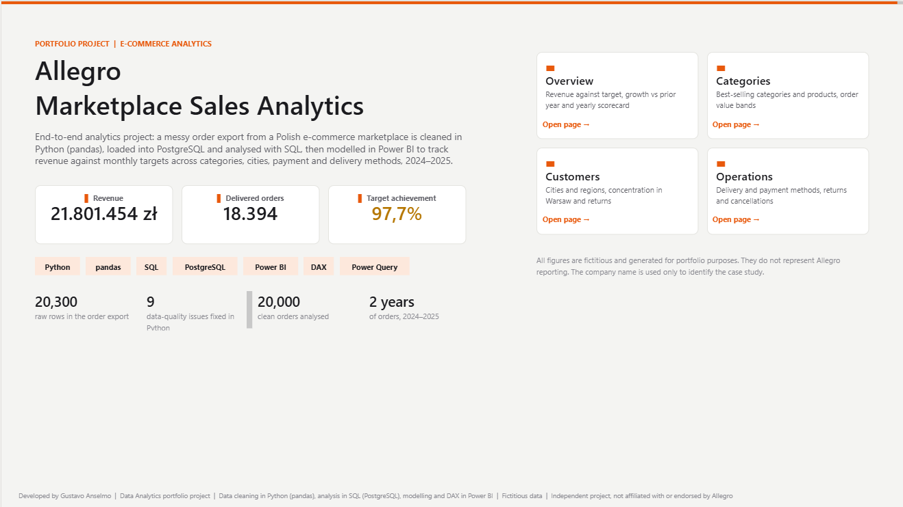
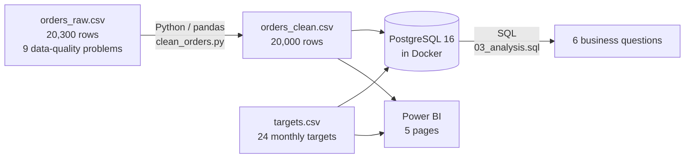
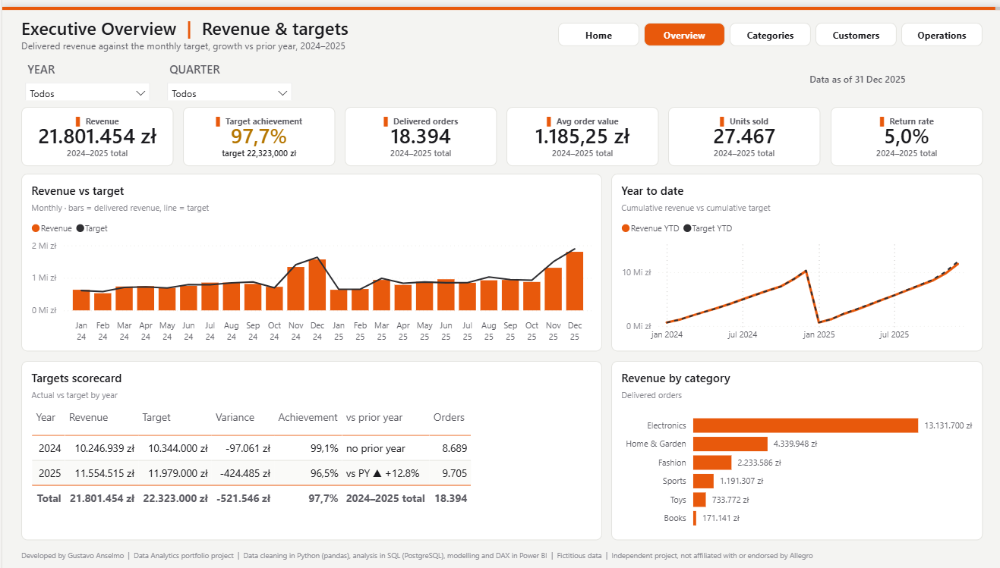
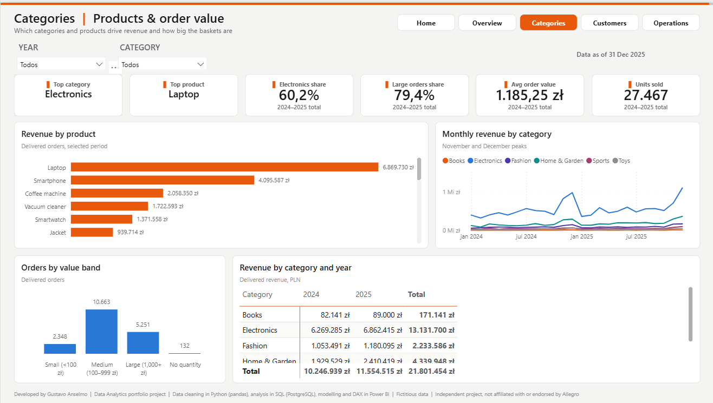
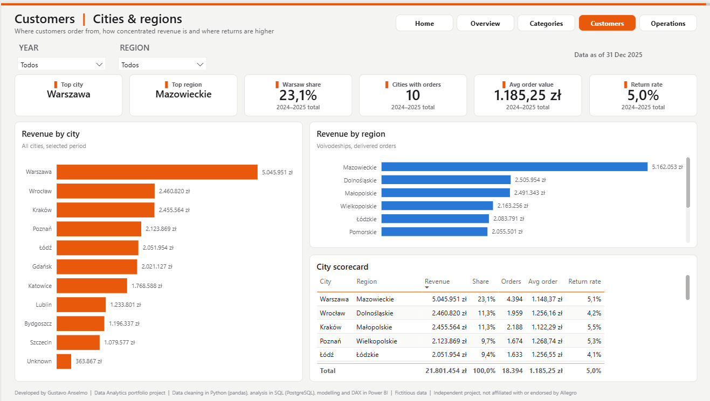
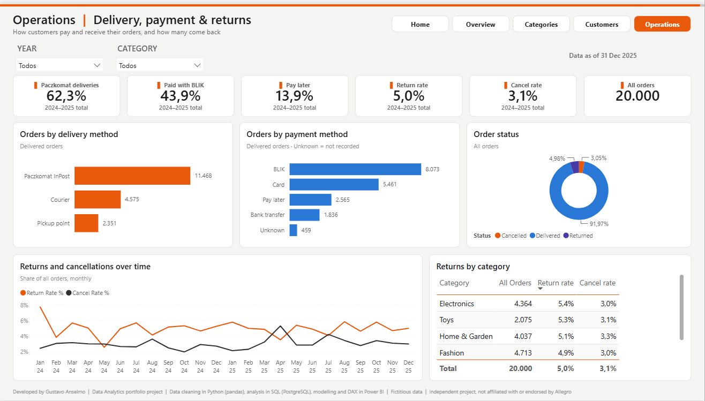

# Allegro | E-commerce Sales Analytics with Python, PostgreSQL (Docker) and Power BI

> End-to-end analytics project: a messy order export from a Polish e-commerce marketplace (20,300 rows) is cleaned in **Python (pandas)**, loaded into **PostgreSQL** running in **Docker**, analysed with **SQL**, and modelled in a 5-page **Power BI** report that tracks revenue against monthly targets across categories, cities, payment and delivery methods, 2024–2025.

> **Disclaimer:** independent portfolio project, not affiliated with or endorsed by Allegro. All figures are fictitious and generated for portfolio purposes. The company name is used only to identify the case study.



---

## At a glance

| | |
|---|---|
| **Business case** | Online orders of a Polish marketplace, Jan 2024 to Dec 2025: 6 categories, 10 cities, 4 payment and 3 delivery methods |
| **Data volume** | **20,300 raw rows** in the order export → **20,000 clean orders** · 24 monthly revenue targets |
| **Data cleaning** | **9 data-quality problems fixed in Python**, from duplicates and missing values to Polish number formats and categories written 21 different ways |
| **Database** | PostgreSQL 16 in **Docker**: one command creates the tables and loads the data (`docker compose up`) |
| **SQL analysis** | **6 business questions** answered with `GROUP BY`, `HAVING`, `CASE WHEN`, `JOIN` and conditional aggregation |
| **Power BI** | 5 pages, model and report saved as code (TMDL + PBIR) |

## Stack

`Python` `pandas` `NumPy` `PostgreSQL` `SQL` `Docker` `pgAdmin` `Power BI` `DAX` `Power Query` `Git`

## Architecture



## Pipeline

| Step | File | What it does |
|---|---|---|
| 1. Clean | `Python/clean_orders.py` | Reads the raw export and fixes 9 data-quality problems (see below), adds `revenue_pln` |
| 2. Create tables | `sql/01_create_tables.sql` | Creates `orders` and `targets` with typed columns (`DATE`, `NUMERIC(10,2)`, `INTEGER`) |
| 3. Load | `sql/02_load_data.sql` | `COPY` loads both CSV files into PostgreSQL |
| 4. Run | `docker-compose.yml` | PostgreSQL 16 container; steps 2 and 3 run automatically on first start (`docker-entrypoint-initdb.d`) |
| 5. Analyse | `sql/03_analysis.sql` | 6 business questions (see below) |
| 6. Report | `dashboard/Allegro_Sales_Analytics.pbip` | Power BI model (Calendar, orders, targets) and 5-page report |

## Highlights

### Data cleaning (Python)

| Problem in the raw export | Rows affected | Fix |
|---|---:|---|
| Column names with spaces, parentheses and a leading space (` Category`, `Unit Price (PLN)`) | all columns | `str.lower()`, `str.strip()`, `str.replace()` → `snake_case` |
| Duplicated rows | 300 | `drop_duplicates()` |
| Missing payment method written as `-` | 500 | read as missing with `na_values` |
| Extra spaces in city names | 1,183 | `str.strip()`, `str.title()` |
| Empty city | 400 | filled with `"Unknown"` |
| Category written 21 different ways (`FASHION`, `Moda`, `Elektronika`, `Home and Garden`...) | 2,400 | mapped to 6 categories with `.map()` and a dictionary |
| Polish number format in prices (`1.299,99`) | 2,000 | `np.where` + `str.replace()`, converted to `float` |
| Quantity zero or negative | 150 | set to missing (`np.nan`), not invented |
| Quantity stored as float, dates as text | all rows | `astype('Int64')`, `pd.to_datetime()` |

### SQL analysis (PostgreSQL)

| # | Question | SQL used |
|---|---|---|
| 1 | Revenue and orders by year | `EXTRACT`, `GROUP BY` |
| 2 | Revenue by category | `GROUP BY`, `ORDER BY ... DESC` |
| 3 | Orders by value band | `CASE WHEN` + `GROUP BY` |
| 4 | Cities with more than 1,500 orders | `HAVING` |
| 5 | Monthly revenue vs target | `JOIN`, `DATE_TRUNC`, `ROUND` |
| 6 | Return rate by category | conditional aggregation `SUM(CASE WHEN ...)` |

### Key findings

| Year | Delivered orders | Revenue (PLN) | Target achievement | vs prior year |
|---|---:|---:|---:|---:|
| 2024 | 8,689 | 10,246,939 | 99.1% | |
| 2025 | 9,705 | 11,554,515 | 96.5% | +12.8% |

- **Revenue grew 12.8% in 2025**, but targets grew faster: achievement fell from 99.1% to 96.5%.
- **Electronics is 60% of revenue**, and the laptop alone brings PLN 6.9M.
- **Warsaw is 23% of revenue**, twice as much as the next city (Wrocław and Kraków, 11% each).
- **BLIK is the top payment method (44%)** and **62% of orders go to InPost parcel lockers**.
- **5.0% of orders are returned**: Electronics has the highest rate (5.4%), Books the lowest (4.2%).

## Power BI report (5 pages)

| Page | Content |
|---|---|
| **Home** | Project summary, headline KPIs, tech stack, data-cleaning numbers, navigation |
| **Overview** | Revenue, orders, average order value, units and return rate; monthly revenue vs target; year-to-date; yearly scorecard; revenue by category |
| **Categories** | Revenue by product, monthly trend by category, orders by value band, category × year matrix |
| **Customers** | Revenue by city and region, Warsaw share, city scorecard with return rate |
| **Operations** | Delivery and payment methods, order status, returns and cancellations over time |

| | |
|---|---|
|  |  |
|  |  |

## Repository structure

```
data/raw/          orders_raw.csv (messy export), targets.csv
data/clean/        orders_clean.csv (output of the Python step)
Python/            clean_orders.py: data cleaning
sql/               01 create tables, 02 load data, 03 business questions
docker-compose.yml PostgreSQL 16 with the init scripts
dashboard/         Allegro_Sales_Analytics.pbip (open in Power BI Desktop)
docs/              screenshots
```

## How to reproduce

**Requirements:** Python 3, Docker Desktop, Power BI Desktop (for the report).

1. Clean the data (optional, `data/clean/` is already in the repo):
   ```
   pip install -r requirements.txt
   python Python/clean_orders.py
   ```
2. Start the database. Tables are created and loaded automatically:
   ```
   docker compose up -d
   ```
3. Connect with pgAdmin or any SQL client: host `localhost`, port `5433`, database `allegro_sales`, user `postgres`, password `teste123` (local demo only). Run `sql/03_analysis.sql`.
4. Open `dashboard/Allegro_Sales_Analytics.pbip` in Power BI Desktop, update the `DataFolder` parameter if your path is different, and click **Refresh**.

To start again from an empty database: `docker compose down -v` and `docker compose up -d`.

## Lessons learned

- **`WHERE` deletes rows, `SUM(CASE ...)` does not:** to get a return *rate*, the total has to stay in the query, so the condition goes inside the aggregation.
- **Integer division:** `234 / 4364` is `0` in SQL; `100.0 * ...` makes it a decimal.
- **Missing is not zero:** a quantity of `-3` or a `-` in payment method becomes a missing value, never an invented one.
- **Containers only see mounted folders:** inside Docker the CSV is at `/data/clean/...`, not `C:\Users\...`; the volume `./data:/data` is the bridge.
- **Init scripts run once:** files in `docker-entrypoint-initdb.d` only run on an empty database, so changes need `docker compose down -v`.
- **A file that does not exist becomes a folder:** Docker created `02_load_data.sql` as an empty directory before the file was saved, and the load failed with "Is a directory".

## Next steps

- [ ] Point the Power BI model to PostgreSQL instead of the CSV files
- [ ] Add data-quality checks in SQL (row counts, nulls, duplicates)

---

Developed by **Gustavo Anselmo** | [LinkedIn](https://www.linkedin.com/in/g-anselmo/) | [GitHub](https://github.com/gustavo03anselmo-afk)
